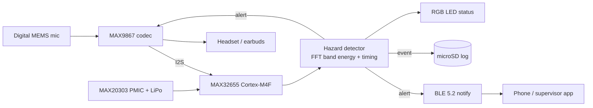

# SonoGuard

**An edge-AI acoustic hazard alert wearable built on the MAX32655FTHR**

SonoGuard listens for hazard sounds (sirens, reversing-vehicle beepers, fire alarms) and alerts people who can't hear them because they are wearing hearing protection or a full-face helmet. Detection runs entirely on the board, with no cloud and no phone required.

> **Status: work in progress.** This README is updated as each milestone is completed. See [Progress log](#progress-log) for what works today.

Built for the *Learn, Build & Win by DigiKey* programme (CircuitDigest x DigiKey x Analog Devices).

---

## Problem

Earmuffs, earplugs and full-face helmets block the sounds people most need to hear: reversing-vehicle beepers, fire alarms, ambulance sirens and shouted warnings. A passive alarm cannot reach someone who is wearing hearing protection. SonoGuard moves the warning into the headset the person is already wearing.

## How it works (planned)



1. The mic audio reaches the MCU over I2S through the MAX9867 codec.
2. The detector looks for known hazard signatures: band energy plus temporal pattern (pulsing tone for a beeper, sweeping tone for a siren).
3. On detection, the board plays an alert tone through the codec into the headset, sends a BLE notification, logs the event to the SD card, and changes the LED state.
4. A cooldown and a mute window stop the board from re-triggering on its own alert.

**Stretch goal:** replace the rule-based detector with a small TinyML audio classifier trained on public sound datasets plus self-recorded samples.

## Hardware

| Item | Details |
|---|---|
| Board | MAX32655FTHR (Analog Devices / Maxim) |
| MCU | Arm Cortex-M4F @ 100 MHz, 512 KB flash, 128 KB SRAM, Bluetooth 5.2 LE |
| Audio | MAX9867 stereo codec, SPH0644HM4H-1 digital mic, 3.5 mm CTIA headset jack |
| Power | MAX20303 PMIC with fuel gauge, USB charging (51 mA) |
| Storage | microSD (SPI mode), 128 Mbit (16 MB) QSPI flash |
| Extras | 1-cell LiPo, wired earbuds, optional vibration motor |

### Pins used

| Function | Pins |
|---|---|
| Console UART | P0.0 RX, P0.1 TX |
| Codec and PMIC I2C | P0.16 SCL, P0.17 SDA |
| Codec I2S | P1.2 SCK, P1.3 WS, P1.4 SDI, P1.5 SDO |
| Codec clock | P0.14 |
| SD card (SPI) | P0.4 CS, P0.5 MOSI, P0.6 MISO, P0.7 CLK, P0.12 detect, P0.15 power enable (active low) |
| Buttons | SW2 = P0.2, SW3 = P0.3 |
| RGB LED (D1) | P0.18 R, P0.19 G, P0.26 B |

## Repository layout

```
firmware/   CodeFusion Studio / MSDK projects (own source files only)
python/     detector prototype, evaluation scripts
docs/       photos, screenshots, diagrams
data/       small sample WAVs (links to public datasets, not copies)
```

## Getting started

**Tools**
- VS Code with the **CodeFusion Studio** extension and SDK (includes the Analog Devices MSDK)
- MAX32655 packages installed through the CFS package manager
- Python 3.10+ for the prototype (`numpy`, `scipy`, `librosa`, `matplotlib`)

**Build and flash**
1. Open the project from `firmware/` in CodeFusion Studio.
2. Set the board target to the MAX32655FTHR (`FTHR_Apps_P1`).
3. Build, then flash over the onboard DAPLink debugger.
4. Open the serial console on the board's COM port at 115200 baud.

## Milestones

- [x] Board received, preloaded BLE demo verified with the LightBlue app
- [x] Toolchain set up, `Hello_World` running with UART output
- [x] Own firmware flashed (LED blink)
- [ ] Codec configured over I2C, mic audio captured to SD as WAV
- [ ] Offline detector prototype in Python, evaluated on public data and own recordings
- [ ] Detector running on-device on live audio
- [ ] Alert tone played through the codec
- [ ] BLE alert notification to phone
- [ ] Event logging to SD card
- [ ] Battery operation, fuel-gauge reading, low-battery alert
- [ ] Stretch: TinyML classifier on-device

## Results

Filled in as measurements are taken.

| Metric | Result |
|---|---|
| Detection accuracy per hazard type | TBD |
| False alarms per hour (noisy environments) | TBD |
| Latency, sound onset to alert | TBD |
| CPU load / RAM use | TBD |
| Battery runtime | TBD |

## Progress log

| Date | Update |
|---|---|
| 2026-10 | Board received. Preloaded BLE demo verified with LightBlue (blue LED blinks and responds). |

## Known limitations

- Passive industrial earmuffs have no audio input. The prototype delivers alerts through earbuds worn under the muffs or a helmet speaker.
- The on-board mic position affects results, so placement on the body or helmet is tested.
- USB charging is limited to 51 mA, so use a small LiPo cell.
- 128 KB RAM is shared with the BLE stack, which limits model size.

## Acknowledgements

CircuitDigest, DigiKey and Analog Devices for the *Learn, Build & Win* programme and the MAX32655FTHR evaluation kit.

## Author

Christy Roy. Contact and links: *add here*.

## License

MIT (add a `LICENSE` file).